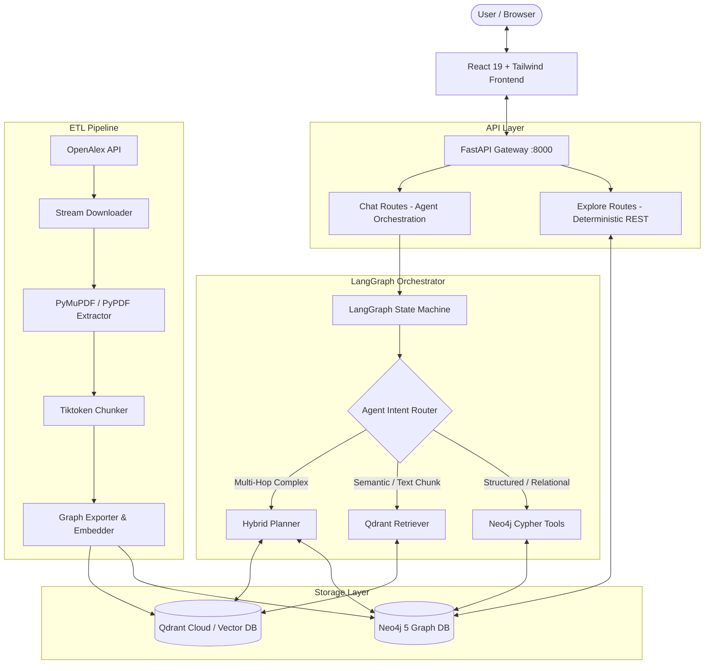

# Hybrid GraphRAG: Academic Knowledge Graph & Vector Search System

[](https://fastapi.tiangolo.com)
[](https://neo4j.com/)
[](https://qdrant.tech/)
[](https://github.com/langchain-ai/langgraph)
[](https://react.dev/)
[](LICENSE)

An end-to-end, enterprise-grade **Hybrid GraphRAG (Retrieval-Augmented Generation)** platform designed for deep exploration and semantic reasoning across massive academic paper corpora.

By unifying the structural relationship intelligence of **Knowledge Graphs (Neo4j)** with high-dimensional vector search (**Qdrant**), this platform eliminates common vector-only RAG limitations—empowering autonomous **LangGraph** agents to perform multi-hop reasoning (up to 4+ degrees of separation) while grounding answers in precise PDF chunk citations.

---

## 📑 Table of Contents

- [Architectural Overview](#-architectural-overview)
- [Key Features](#-key-features)
- [System Architecture](#-system-architecture)
- [Repository Structure](#-repository-structure)
- [Prerequisites & Requirements](#-prerequisites--requirements)
- [Quick Start Guide](#-quick-start-guide)
  - [1. Environment Setup](#1-environment-setup)
  - [2. Database Provisioning (Docker or Cloud)](#2-database-provisioning-docker-or-cloud)
  - [3. Running the Backend](#3-running-the-backend)
  - [4. Running the Frontend](#4-running-the-frontend)
- [Data Ingestion Pipeline](#-data-ingestion-pipeline)
- [Graph Schema & Multi-Hop Querying](#-graph-schema--multi-hop-querying)
- [Dual-Interface API Design](#-dual-interface-api-design)
- [Evaluation & Fallback Mechanism](#-evaluation--fallback-mechanism)
- [License](#-license)

---

## 🏛 Architectural Overview

Standard vector-only RAG excels at localized passage lookup, but fails when answering complex queries that span networks of entities (e.g., *"What institutions produced the papers cited by ResNet?"*).

**Hybrid GraphRAG bridges this divide:**
1. **Knowledge Graph (Neo4j):** Encodes authors, institutions, venues, topics, keywords, years, and direct citation chains (`[:CITES]`, `[:WRITES]`, `[:AFFILIATED_WITH]`).
2. **Dense Vector Store (Qdrant):** Indexes semantic embeddings (1536-dimensional via `text-embedding-3-small`) of parsed, token-bounded PDF text chunks.
3. **Agentic Router (LangGraph):** Dynamically chooses between Cypher graph tools, semantic chunk retrieval, or hybrid traversal based on user intent.
4. **Deterministic REST Layer:** Provides sub-millisecond, non-LLM endpoints for UI graphs, tables, and dashboards to eliminate unnecessary token latency.

---

## ✨ Key Features

- **4-Stage Resilient Ingestion Pipeline:**
  - Streaming PDF retrieval with byte-level timeouts.
  - Cryptographic integrity verification via chunked SHA-256 hashing.
  - Primary `PyMuPDF` parser with automated font-corruption fallback to `PyPDF`.
  - Token-aware chunking (`tiktoken` / `cl100k_base`) with sliding window overlaps.
- **Autonomous Multi-Hop Agent:** Powered by LangGraph state machines equipped with self-correcting query tools, schema validation, and parameter sanitization.
- **Derived Graph Analytics:** Automated post-ingestion algorithms compute co-authorship networks (`[:COLLABORATES_WITH]`), topic correlation matrices (`[:RELATED_TO]`), and venue coverage profiles (`[:COVERS]`).
- **Resilient Fallback Handling:** Automatic recovery mechanism that catches graph/vector connectivity failures and seamlessly degrades to high-quality baseline synthesis.
- **Modern Interactive Frontend:** React 19 UI with Tailwind CSS, React Flow visualizers, and Framer Motion animations.

---

## 📐 System Architecture



---

## 📁 Repository Structure

```
├── data/
│   ├── raw/                 # Raw OpenAlex JSON and downloaded PDFs
│   ├── intermediate/        # Extracted JSON text from PDFs
│   ├── processed/           # Bulk-loadable JSONL nodes and relationships
│   └── state/               # Deduplication and entity-tracking state
├── frontend/                # React 19 + TypeScript + Vite web app
│   ├── src/                 # Components, routes, visualizers
│   └── package.json         # Frontend dependencies
├── src/
│   └── hybrid_graphrag/
│       ├── agent/           # LangGraph workflow, state schemas, routing nodes
│       │   └── tools/       # Graph and vector execution tools
│       ├── api/             # FastAPI application
│       │   ├── main.py      # Entry point & CORS middleware
│       │   └── routes/      # Chat and explore endpoints
│       ├── graph/           # Neo4j client, schema definitions, Cypher loaders
│       ├── ingestion/       # OpenAlex fetcher, PDF streamer, parser, chunker
│       ├── vector/          # Qdrant client, embedder wrapper
│       ├── cli.py           # Administrative command-line interface
│       ├── config.py        # Pydantic-Settings environment validation
│       └── logging.py       # Structured telemetry and log formatters
├── docker-compose.yml       # Neo4j & Qdrant local container orchestration
├── Dockerfile               # Production container image
├── requirements.txt         # Core Python dependencies
└── .env.example             # Environment configuration template
```

---

## ⚡ Quick Start Guide

### 1. Prerequisites
- **Python:** 3.10+
- **Node.js:** 18+ and `npm`
- **Docker & Docker Compose** *(Optional if using Neo4j Aura & Qdrant Cloud)*

### 2. Environment Setup

Clone the repository and copy the environment template:
```bash
git clone https://github.com/your-username/hybrid-graphrag.git
cd hybrid-graphrag
cp .env.example .env
```

Configure the following variables in `.env`:
```env
OPENAI_API_KEY=sk-...

# Neo4j (Local Docker or Neo4j Aura)
NEO4J_URI=neo4j+s://<db-id>.databases.neo4j.io
NEO4J_USERNAME=neo4j
NEO4J_PASSWORD=<password>

# Qdrant (Local Docker or Qdrant Cloud)
QDRANT_URL=https://<cluster-id>.qdrant.io
QDRANT_API_KEY=<qdrant-key>
```

### 3. Database Provisioning (If Running Locally)

If you prefer to run Neo4j and Qdrant locally rather than using cloud instances:
```bash
docker-compose up -d neo4j qdrant
```

---

### 4. Running the Application

#### Terminal 1: Backend Server (FastAPI)
```powershell
# Create and activate virtual environment
python -m venv venv
.\venv\Scripts\Activate.ps1   # On Linux/macOS: source venv/bin/activate

# Install dependencies
pip install -r requirements.txt

# Start backend server
uvicorn src.hybrid_graphrag.api.main:app --reload
```
*API will be available at: `http://localhost:8000` (Swagger docs at `/docs`)*

#### Terminal 2: Frontend Dashboard (React + Vite)
```powershell
cd frontend
npm install
npm run dev
```
*Frontend will be live at: `http://localhost:5173`*

---

## 🔄 Data Ingestion Pipeline

To populate or refresh the system with papers from OpenAlex:

```bash
# 1. Fetch metadata and stream PDFs
python -m src.hybrid_graphrag.cli fetch-papers --query "machine learning" --limit 50

# 2. Extract and parse PDF text
python -m src.hybrid_graphrag.cli extract-text

# 3. Chunk text into token-bounded windows
python -m src.hybrid_graphrag.cli chunk-documents

# 4. Generate embeddings and load Qdrant
python -m src.hybrid_graphrag.cli load-vectors

# 5. Populate Neo4j graph and calculate derived edges
python -m src.hybrid_graphrag.cli load-graph
```

---

## 🕸 Graph Schema & Multi-Hop Querying

### Core Entities & Relationships

| Node Type | Outgoing Relationship | Target Node | Semantics |
| :--- | :--- | :--- | :--- |
| `Author` | `[:WRITES]` | `Paper` | Paper authorship |
| `Paper` | `[:CITES]` | `Paper` | Direct citation graph |
| `Author` | `[:AFFILIATED_WITH]` | `Institution` | Institutional research affiliation |
| `Paper` | `[:PUBLISHED_IN]` | `Venue` | Conference or journal publication |
| `Paper` | `[:HAS_TOPIC]` | `Topic` | High-level research topic |
| `Paper` | `[:HAS_CHUNK]` | `Chunk` | Direct connection to Qdrant vector chunk |
| `Author` | `[:COLLABORATES_WITH]` | `Author` | *(Derived)* Co-author relationship |

### Sample Multi-Hop Cypher Traversal
Finding the universities that produced papers cited by a given publication (3 Hops):
```cypher
MATCH (p:Paper {title: "Deep Residual Learning for Image Recognition"})-[:CITES]->(cited:Paper)
MATCH (cited)<-[:WRITES]-(author:Author)-[:AFFILIATED_WITH]->(inst:Institution)
RETURN inst.display_name, count(distinct cited) AS cited_papers_count
ORDER BY cited_papers_count DESC
LIMIT 10;
```

---

## 🚀 Dual-Interface API Design

To maximize responsiveness while optimizing OpenAI API token usage, this system implements a dual-layer architectural pattern:

1. **Agentic NLP Interface (`/api/chat`):** Used for open-ended, complex research questions requiring multi-tool synthesis, step-by-step reasoning, and vector search.
2. **Direct Entity Interface (`/api/explore`):** High-speed, deterministic REST endpoints (`/institutions`, `/authors`, `/topics`, `/papers`) executing pre-compiled Cypher queries in milliseconds without invoking LLM tokens.

---

## 🛡 License

This project is licensed under the MIT License — see the [LICENSE](LICENSE) file for details.
